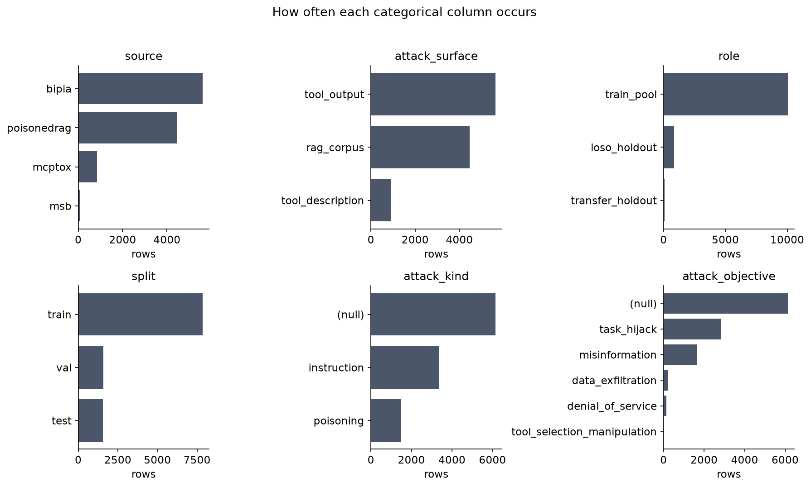
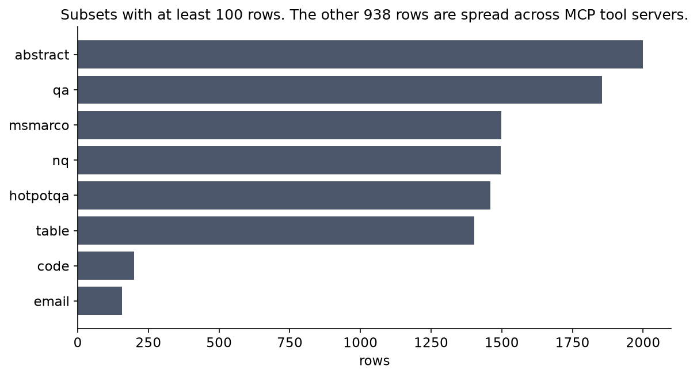
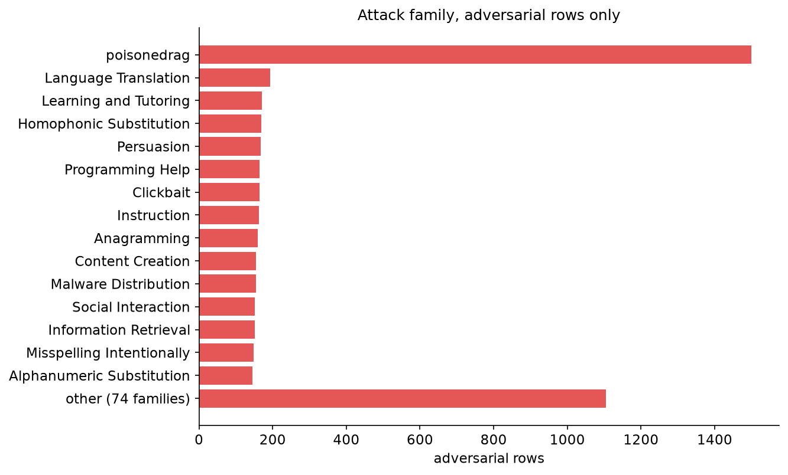
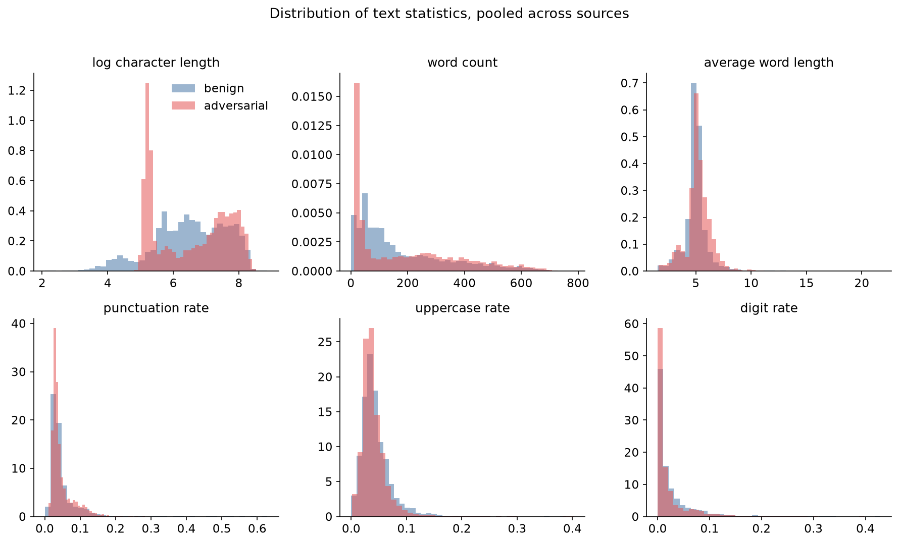
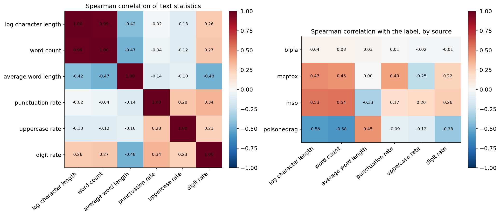
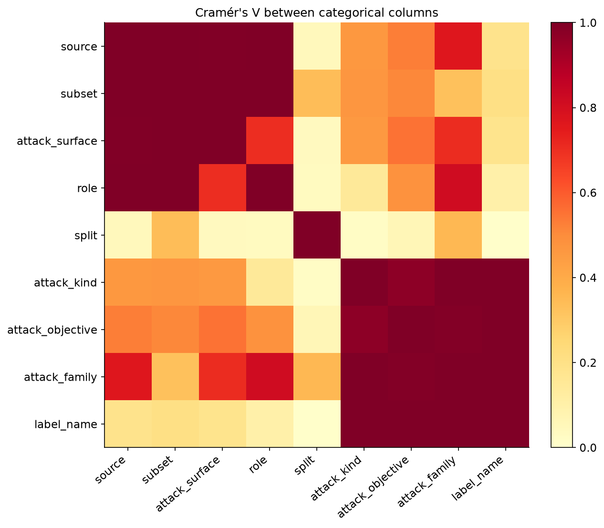
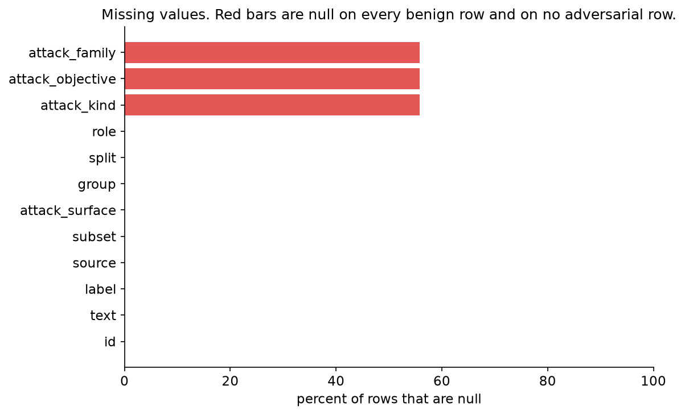
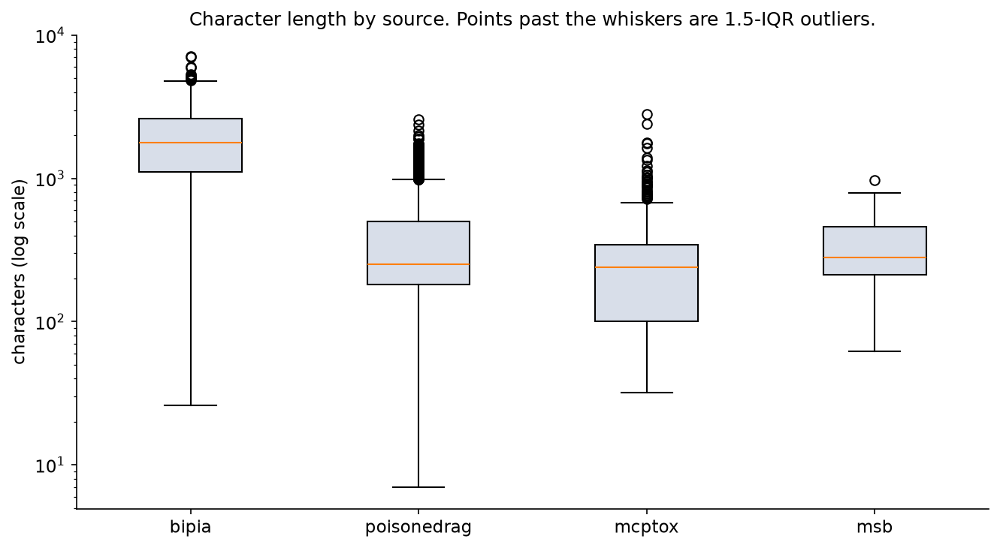
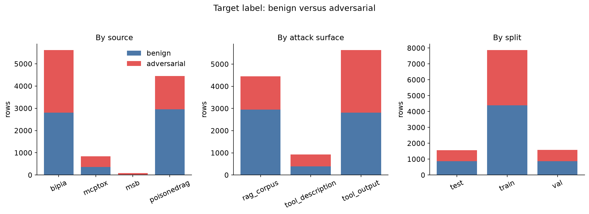
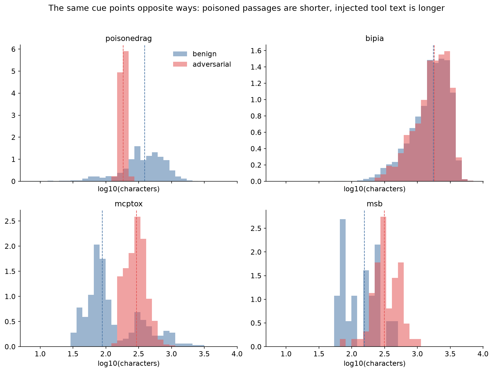

# Phase 3 visual data

Figures for the unified corpus in `data/processed/dataset.parquet`: 11,005 rows, 4,861 adversarial and 6,144 benign. Regenerated by `uv run python notebooks/phase3_eda.py`. The stored columns are categories plus the raw text. The numeric plots use statistics computed from `text` (length, word count, punctuation, uppercase, digits). Those statistics are for exploration. They are not extra columns in the dataset.

## Distribution of each column

`source`, `attack_surface`, `role`, `split`, `attack_kind` and `attack_objective`:

`subset` has 60 values. Eight collections hold almost all of the rows. The rest are individual MCP tool servers, each with a few dozen rows, so they are counted in the caption rather than drawn as sixty bars.

Attack family, counted on adversarial rows only. Benign rows leave this field empty on purpose. PoisonedRAG is one family of 1,500 rows; the long tail is BIPIA's attack categories.

Text statistics, pooled. Pooling hides the pattern in the last figure: a single histogram of length looks almost the same for both classes because PoisonedRAG and the tool sources pull in opposite directions.

## Correlation

Left: Spearman correlation among the text statistics. Length, word count and log length move together, which is expected. Right: the same statistics' correlation with `label`, computed separately inside each source. Log length correlates about -0.56 with the label on PoisonedRAG and about +0.47 on MCPTox.

| Source | Spearman(log length, label) | Benign median characters | Adversarial median characters |
|---|---|---|---|
| bipia | +0.04 | 1,752 | 1,816 |
| mcptox | +0.47 | 88 | 292 |
| msb | +0.53 | 156 | 314 |
| poisonedrag | -0.56 | 389 | 183 |

Cramér's V measures association between the categorical columns. `source` and `attack_surface` are nearly the same fact: only MSB uses more than one surface. `attack_kind`, `attack_objective` and `attack_family` associate perfectly with `label` once their empty benign cells are filled in, because those cells are empty exactly when the row is benign.

## Missing data

Blank text would count as missing. There is none. The only nulls are the three attack fields, and every one of them sits on a benign row.

| Column | Nulls | On benign rows | On adversarial rows |
|---|---|---|---|
| attack_family | 6,144 | 6,144 | 0 |
| attack_kind | 6,144 | 6,144 | 0 |
| attack_objective | 6,144 | 6,144 | 0 |

A model that is allowed to see `attack_kind` can read the label off the missingness. Training uses `text` and `label` only.

## Outliers

An outlier is a character length outside the 1.5-IQR fences of its own source. The long BIPIA documents are real emails, articles and tables, not broken rows. PoisonedRAG's adversarial texts are short because the attack writes a short passage, not because those rows are corrupt.

| Source | Outlier rows | Share | Shortest | Longest |
|---|---|---|---|---|
| bipia | 14 | 0.2% | 26 | 7,107 |
| mcptox | 35 | 4.1% | 32 | 2,818 |
| msb | 1 | 1.1% | 62 | 972 |
| poisonedrag | 178 | 4.0% | 7 | 2,569 |

## Target

The label is close to balanced overall (44.2% adversarial) and inside the train, validation and test splits. It is not balanced inside a source. MSB `tool_output` has adversarial rows and no benign rows, so a detector can look accurate on that slice by always saying adversarial.

## Non-obvious insight: length reverses direction

A length histogram of the whole corpus suggests length does not separate the classes. Split by source, it does, and the direction flips.

On PoisonedRAG the adversarial passages sit to the left of the benign retrieved passages: the attack text is shorter than a real passage. On MCPTox and MSB the adversarial tool text sits to the right: the injection makes the description longer. On BIPIA the two histograms lie on top of each other. The dashed lines are medians.

That is why a length-only model fit on the pooled training set looks useless in-distribution and then looks strong on MCPTox and MSB. It learned one direction and the held-out tool descriptions happen to match that direction, while PoisonedRAG matches the other one. Any detector score has to be compared with length inside each source. The numbers for that comparison are already in `DATA_CARD.md`, from `src/models/baselines.py`.
